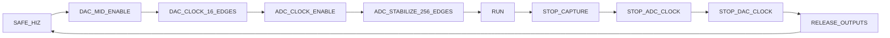

# 第二步：复位、时钟抽象与安全状态机

状态：2026-10-21 已完成行为仿真验收。工具为 Vivado/XSim 2025.2，延续临时器件 `xc7a35tcsg324-1`，没有选择开发板预设，没有加入 EGO1 XDC 或最终管脚约束。

## 文件与接口

| 文件，相对工程根目录 | 职责 |
|---|---|
| `FPGA/rtl/common/scope_pkg.sv` | 时钟档位、8192 中码、16/256 常量及 4 位状态类型 |
| `FPGA/rtl/clock_reset/scope_reset_sync.sv` | 异步置位、两拍同步释放，可选择上升沿或下降沿 |
| `FPGA/rtl/clock_reset/scope_enable_sync.sv` | 使能两拍资格确认，撤销使能异步清除资格 |
| `FPGA/rtl/clock_reset/scope_safe_ctrl.sv` | 启动、关断和重启的状态及边沿计数 |
| `FPGA/rtl/top/scope_core.sv` | 核心接口、安全屏蔽及 DAC 中码；直接接收采样时钟 |
| `FPGA/rtl/top/scope_hw_top.sv` | Clocking Wizard、3 个 ODDR、17 个 OBUFT 的硬件包装 |
| `FPGA/sim/models/ideal_clock.sv` | 仅仿真的理想时钟，1 ps 量化 |
| `FPGA/sim/models/scope_pin_model.sv` | 仅仿真的外部引脚模型，观察高阻 |
| `FPGA/sim/tb/safe_scenario.sv`、`tb_safe.sv` | 四档核心测试、100 MHz 复位测试、独立 scoreboard 与覆盖 |
| `FPGA/sim/tb/tb_hw_safe.sv` | 真实 IP/UNISIM 包装层集成测试 |

`scope_core` 的输入是 `clk_sample`、高有效 `arst`、`clock_locked`、`module_enable` 和 `clock_restart`。控制输出是 `dac_data_oe`、`dac_clk_oe`、`adc_clk_oe`、`capture_enable`；另提供 DAC 数据、状态及复位/资格观察信号。高阻只在引脚模型和硬件 OBUFT 边界出现，不进入普通算术逻辑。

全部手写 SV 使用 `timeunit 1ns; timeprecision 1ps;` 和 `default_nettype none`。无手写 RTL 寄存器声明初值或 `initial` 替代复位。供应商 IP/原语使用其自带模型；ODDR 的 INIT 参数之外还有明确的复位连接。

## 复位方式与时钟结构

本阶段明确采用安全复位例外：复位或 MMCM 失锁必须能在没有等待下一拍的情况下停止驱动，因此复位链和控制状态机使用异步置位；解除复位由 `scope_reset_sync` 在本地两个有效边沿后同步完成。100 MHz 复位助手检查上升沿释放，采样核心使用下降沿释放。

`scope_enable_sync` 连续采到两次高电平才建立使能资格；低电平异步取消资格，即使低脉冲完全落在两个下降沿之间也会触发完整关断。它提供两拍资格确认，不等同于毫秒级机械按键消抖。

核心不产生时钟，所有时序模块直接使用传入的 `clk_sample`。状态和普通时钟 OE 在其下降沿更新。硬件路径为 `100 MHz → Clocking Wizard/MMCM → BUFG → 核心与 ODDR.C`；没有用组合逻辑或计数器输出作为内部时钟。硬件包装目前固定产生 25 MHz，四档功能测试直接用 testbench 产生的 10/25/50/65 MHz 时钟，不依赖 Clocking Wizard 锁定过程。

包装层测试在时钟两个相位检查核心三个时钟端口与实际 Wizard BUFG 输出相同；本次通过 1117 次连接检查。源码中的时钟连接也已逐项核对。此项是结构核查和行为验证，没有代替布局布线后的时钟/时序分析。

## 启动与退出约定



任一启动/运行状态均可因撤销使能或 `clock_restart` 转入 `STOP_CAPTURE`。复位或失锁从任意状态异步回到 `SAFE_HIZ`，并立即屏蔽输出。

| 状态 | 保持/动作 |
|---|---|
| SAFE_HIZ | DAC 数据、ACLK、WR1、ADC CLK 全部高阻，采集禁止 |
| DAC_MID_ENABLE | 只驱动 14 位 DAC 中码 8192，时钟仍高阻，保持一个控制周期 |
| DAC_CLOCK_16_EDGES | 开启同相 ACLK/WR1；至少完成 16 个有效上升沿后允许 ADC 时钟 |
| ADC_CLOCK_ENABLE | 开启 ADC CLK，第一 ADC 上升沿计入稳定等待 |
| ADC_STABILIZE_256_EDGES | 连同前一状态的第一沿，累计满 256 个 ADC 上升沿 |
| RUN | 允许采集，保持数据与时钟使能 |
| STOP_CAPTURE | 保持原来已开启的时钟，采集已禁止，不开启原本未开启的时钟 |
| STOP_ADC_CLOCK | 关闭 ADC 时钟方向输出 |
| STOP_DAC_CLOCK | 关闭 ACLK/WR1 方向输出 |
| RELEASE_OUTPUTS | 关闭 DAC 数据方向输出，再返回 SAFE_HIZ |

正常撤销使能后，`capture_enable` 立即为 0；最迟到第 4 个后续下降沿，所有模块方向引脚均为 Z；第 5 个下降沿进入 `SAFE_HIZ`。关断途中重新置位使能也必须走完退出序列，再从中码和 16/256 边沿重新启动。复位和失锁属于紧急屏蔽，不等待上述有序退出。

计数器分别是显式无符号 4 位和 8 位，阈值、增量和转换均显式定宽；没有舍入。测试基准累计实际引脚上升沿，不读取 DUT 内部计数器。

ODDR 在输出关闭时被明确复位为 0，避免解除高阻时暴露一个已经为高的内部 Q，制造额外的 Z→1 事件。真实原语测试独立计数实际引脚沿，仍要求采集开启时 ADC 沿数恰为 256。

## 验收覆盖与结果

核心回归：`FPGA/reports/safe/20261021_185552_45617a10/`。两个种子 20261020、42 均 PASS，默认种子还在同一个已编译快照上启动新 XSim 进程重放；随机签名、检查结果、状态/转移覆盖及终止标记完全一致，证据见 `replayed_evidence.txt`。

以下覆盖在四个起始时钟档位和两个种子中均达到要求：

| 覆盖项 | 每档每种子的结果 |
|---|---|
| 合法状态 | 10/10 全部到达 |
| 关键转移 | 18/18，包括启动、有序退出、5 条撤销路径及 4 条必要自环 |
| 复位 / 失锁注入 | 2 × 10 = 20/20，覆盖每个启动及退出状态；故障后 5 ps 检查安全输出 |
| 各启动/运行阶段撤销使能 | 5/5 |
| 各启动/运行阶段请求重启 | 5/5 |
| 关断途中重新使能 | 4/4，均先回到高阻再重新启动 |
| 计数边界撤销 | 4/4：DAC 第 15/16 沿、ADC 第 255/256 沿 |
| 两个下降沿之间的低脉冲 | 5/5 活动阶段均捕获并关断 |
| 短高脉冲 | 跨一个下降沿仍不足以建立资格，输出保持高阻 |
| 换频 | 先停止并确认高阻，再改变理想时钟，重新执行 16/256 等待 |
| 随机撤销 | 每档每种子 16 次，保存实际随机选择的 32 位签名 |

100 MHz 上升沿复位释放也单独 PASS。每次等待状态都有周期上限；启动监视器对每个未取消的启动段检查 290 拍上限，关断监视器不因重新使能而延长截止时间，顶层另有 5 ms 看门狗。持续驻留 RUN 以及 SAFE_HIZ 等待请求属于正常状态。

两种子共记录 644085 次计数检查，另有未纳入该计数的断言；同种子重放单独记录。所有断言失败均 `$fatal`，全部通过才有终止 `TEST_PASS`，没有关闭断言或降低失败级别。

工程模式与真实包装层：`FPGA/reports/safe_project/20261021_190440_fe649239/`。

- 工程模式 `tb_safe` 完成同一覆盖矩阵并 PASS。
- `tb_hw_safe` 使用实际 Clocking Wizard、3 个 ODDR、17 个 OBUFT，完成两次启动与复位/关断检查，PASS。
- 完成 2120 次时钟间隔检查；完整高/低半周期为 20 ns。由高阻释放形成的首段低电平单独按 20.1 ns 检查，因为本机 UNISIM ODDR 的 C→Q 模型延迟为 100 ps。本机 `ODDR.v` 的 specify 及 [AMD UG892 2025.2](https://docs.amd.com/r/2025.2-English/ug892-vivado-design-flows-overview/Using-Structural-Netlists-for-Simulation) 均给出这一模型约定。保持 ±1.1 ps 检查容差，没有用增大容差掩盖差异。
- 编译、展开和运行的 HDL 日志零 WARNING、ERROR、Fatal；源文件哈希检查通过。
- Design Sources 的综合编译顺序不依赖模型或 testbench；工程顶层为 `scope_hw_top`，仿真顶层为 `tb_safe`，XSim，工程约束文件 0 个。

## 复跑方法

```powershell
& 'D:\示波器\FPGA\scripts\run_safe_tb.ps1'
& 'D:\示波器\FPGA\scripts\check_safe_project.ps1'
```

第一条默认运行种子 20261020、42，并重放第一个种子；`-Seeds 7,123` 可更换入口，`-SkipReplay` 可显式跳过重放。两条命令默认使用仓库 `vivado_toolchain.json` 中的 Vivado 2025.2。GUI 运行本阶段选 `tb_safe`；真实包装层测试可单独选 `tb_hw_safe`，之后恢复 `tb_safe`。脚本均检查日志和终止标记，不能只看进程返回码。

## 开发诊断与适用边界

保留的开发失败记录不是最终通过结果：

- `safe/20261021_185321_11060e49`：新增短低脉冲用例使原启动监视器把被取消的启动和下一次启动合并计时；同种子在同一时刻复现后修正了监视器的计时边界，保留原 290/5 拍期限。
- `safe/20261021_185441_6d8ed82a`：18 条转移验收发现缺少明确 RUN 自环驻留；补充连续运行及输出稳定断言，保留转移覆盖门槛。
- `safe_project/20261021_185844_cb49fd95`：首段低电平原先误按零延迟模型预期 20 ns；核对实际 UNISIM 源码后修正黄金模型，保存了失败 WDB 与日志。直接用命令行重放该工程快照又出现 DLL 初始化/共享文件映射错误，未作为功能验收；最终完整工程模式重新编译并通过，无安装补丁或 RTL 绕过。官方资料搜索未找到与该独立重放错误完全匹配的 Answer Record，未据此宣称已定位其工具根因。

Vivado 启动时仍可能报告安装自带其他系列板卡预设对应器件未安装等提示，原日志保留，未屏蔽；它们与 HDL 编译警告分开记录。

本阶段验收范围是数字行为、周期、已定义状态可达性和受测条件下的有界进展；没有执行形式化证明、CDC 签核、综合实现、最终 IO 时序或上板电气验收。10/50/65 MHz 目前是核心仿真档位，硬件包装仍为 25 MHz，`clock_restart` 是核心抽象接口，尚未实现硬件动态换频。人工使能仍以外部已确认电源及共地为前提，本模块不检测外部 5 V。后续数据路径应在 `capture_enable` 有效后才运行，并按各自时钟域明确处理复位和控制同步。
